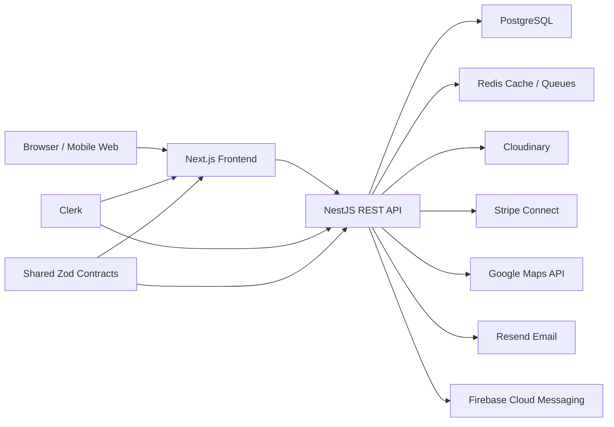

# Architecture

GearShare is structured as a modular monorepo so each product layer can evolve independently while sharing domain contracts.

## Frontend

- Next.js App Router.
- TypeScript and TailwindCSS.
- shadcn-style local UI primitives.
- Marketplace landing page and equipment browse route.
- Clerk provider, sign-in/sign-up pages, protected dashboard, and session-token API calls.
- Owner dashboard tools for listing CRUD, image metadata, availability, and publish state.

## Backend

- NestJS modules by product capability.
- Prisma for database access.
- Global validation, rate limiting, versioning, and Swagger.
- Clerk JWT verification for protected API routes.
- Current-user and role guards for renter, owner, and admin workflows.
- Owner equipment CRUD APIs and signed Cloudinary upload parameter generation.
- Feature modules will own controllers, services, DTOs, policies, and jobs.

## Data

- PostgreSQL is the source of truth.
- Redis is reserved for caching, rate-limit storage, background jobs, and realtime fanout.
- Cloudinary stores equipment images.
- Equipment images are uploaded directly from the browser with short-lived API signatures generated by the backend.
- Stripe Connect owns payment intent, transfer, and payout operations.
- Prisma migrations and idempotent seed data live under `backend/prisma`.
- Denormalized equipment counters are recalculated through the equipment aggregate service.

## Scalability Targets

The schema and module boundaries are intended to support:

- 100,000 users.
- 1 million equipment listings.
- Horizontal API scaling.
- CDN-backed images.
- Queue workers for notifications, payments, moderation, search indexing, and review aggregation.

## Security Controls

- JWT authentication.
- Role grants for renters, owners, and admins.
- DTO validation and Prisma query builders to avoid SQL injection.
- Helmet, CORS allowlisting, and rate limiting.
- Secure external image uploads.
- Audit logs for sensitive actions.
- Admin moderation tables for reports, disputes, reviews, and claims.
