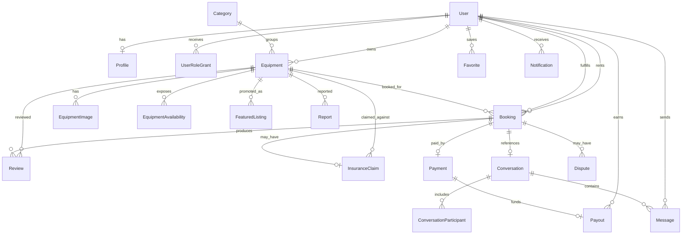

# ER Diagram

## Core Tables

- `User`: platform account linked to external auth.
- `Profile`: public identity, verification, and payout metadata.
- `UserRoleGrant`: flexible role assignment for renters, owners, and admins.
- `Category`: hierarchical equipment taxonomy.
- `Equipment`: rentable listing with pricing, deposit, condition, location, and search fields.
- `EquipmentImage`: Cloudinary-backed listing media.
- `EquipmentAvailability`: date-level availability controls.
- `Booking`: rental lifecycle and price breakdown.
- `Payment`: Stripe payment intent and platform fee accounting.
- `Payout`: owner payout tracking.
- `Conversation`, `ConversationParticipant`, `Message`: booking-aware realtime messaging.
- `Review`: ratings, written reviews, owner replies, and moderation state.
- `Favorite`: saved listings.
- `Notification`: email, push, and in-app notification records.
- `InsuranceClaim`: damage protection workflow.
- `FeaturedListing`: paid listing promotion windows.
- `Report`, `Dispute`, `AuditLog`: moderation, dispute resolution, and security traceability.
